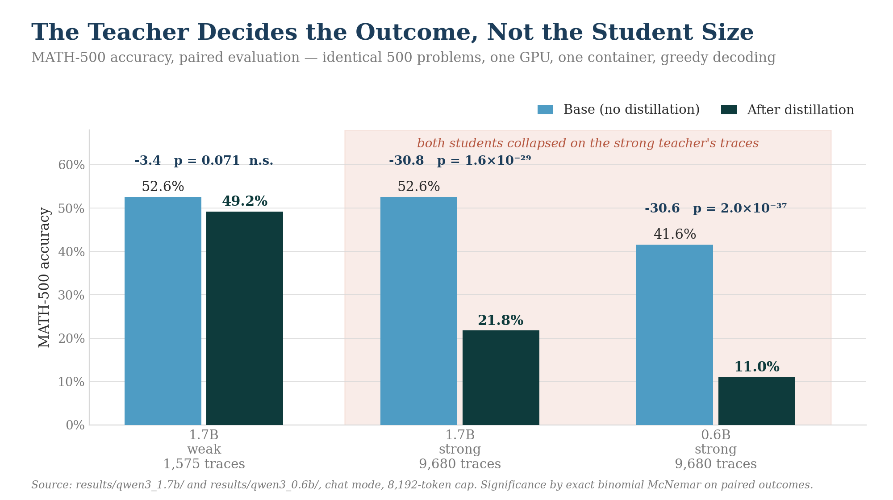
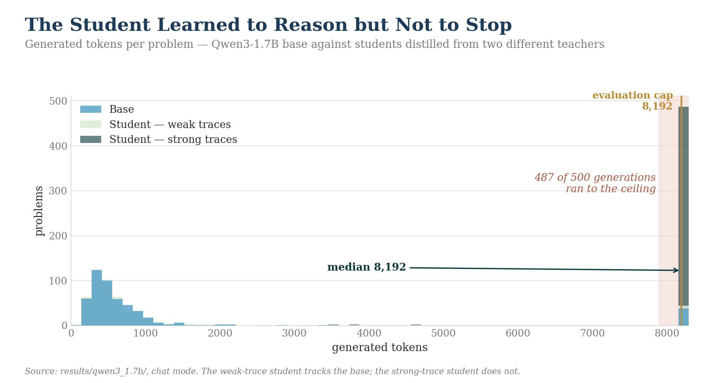
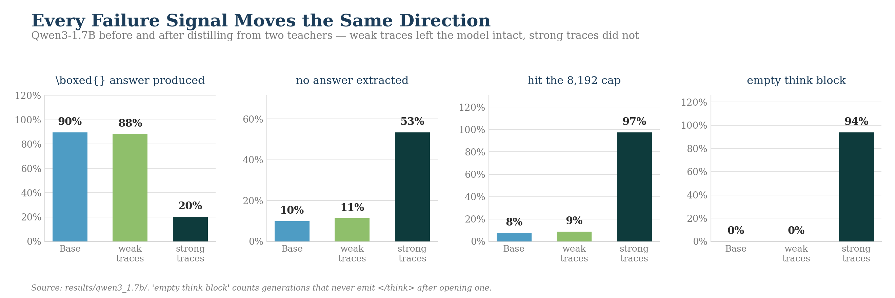
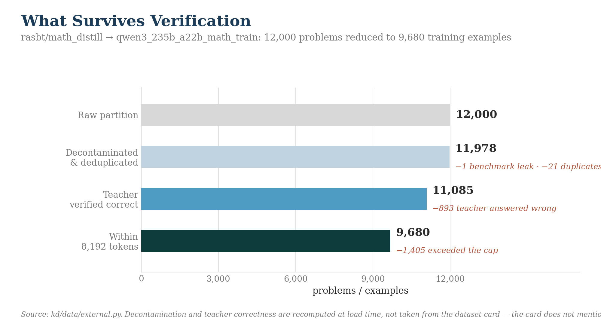
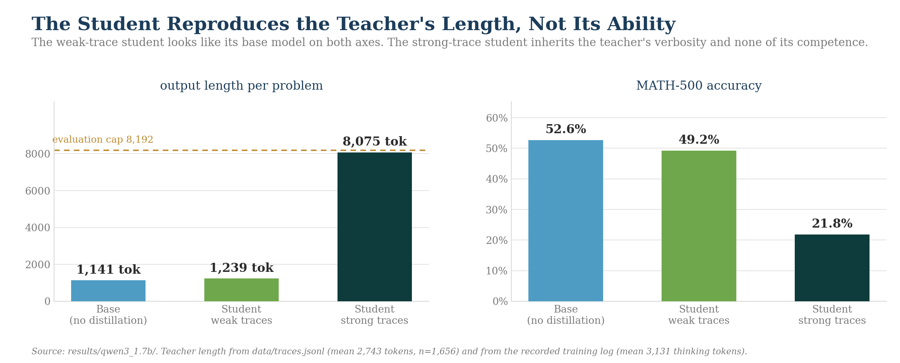

<h1 align="center">Off-Policy Distillation of Reasoning Traces into Small Language Models</h1>

<p align="center"><b>Can a small model learn to reason by imitating a much larger reasoning model?</b></p>

<p align="center"><em>NO. Slm performs worse.</em></p>

<p align="center">
  
  <a href="https://huggingface.co/datasets/rasbt/math_distill"></a>
  <a href="https://huggingface.co/Qwen/Qwen3-235B-A22B"></a>
  
  
  
  
</p>

---

## Result

Every cell trained by sequence-level (hard) distillation on full reasoning traces. All runs paired on identical problems.

| student | teacher | traces | base | distilled | Δ | McNemar *p* |
|---|---|---|---|---|---|---|
| Qwen3-1.7B | Qwen3-32B (weak) | 1,575 | 52.6% | 49.2% | −3.4 | 0.071 |
| Qwen3-1.7B | Qwen3-235B-A22B | 9,680 | 52.6% | **21.8%** | **−30.8** | 1.6 × 10⁻²⁹ |
| Qwen3-0.6B | Qwen3-235B-A22B | 9,680 | 41.6% | **11.0%** | **−30.6** | 2.0 × 10⁻³⁷ |

**Nothing improved.** The 1.7B survived a weak teacher almost intact and was destroyed by a strong one — same student size, opposite outcome. Student capacity is not what separates these rows.



---

## Why

The student copies the teacher's *shape* — open a think block, deliberate at length — without inheriting its ability to finish.



Measured on the 1.7B distilled from Qwen3-235B, against its own base model:

| | base | after |
|---|---|---|
| mean output tokens | 1,141 | **8,075** |
| hit the 8,192 cap | 38/500 | **487/500** |
| never closed `</think>` | 0% | **94%** |
| no answer extracted | 10% | **53%** |
| emitted `\boxed{}` | 90% | **20%** |

A real generation, verbatim:

> `Okay, so I need to convert the rectangular coordinates (0, 3)...`
> ` wait, wait. Wait, wait, wait. Wait, wait, wait. Wait, wait, wait. ...`

Off-policy training cannot see any of this. The student is never graded on its own output, so a run that never terminates is indistinguishable from one that solves the problem.



---

## Data

Teacher traces are re-verified at load time rather than trusted from the dataset card — the card claims zero benchmark overlap and is wrong by one problem.





---

## Method

- **Paired evaluation.** Base and student scored in one container on one GPU over identical problems through one scorer. Greedy decoding is only reproducible within a fixed hardware path.
- **Exact McNemar** on discordant pairs, never a difference of two proportions.
- **Three-tier answer matching** — normalised string, numeric, symbolic — with the tier recorded per sample.
- **No KL divergence.** Plain next-token cross-entropy on teacher tokens; the teacher is never loaded during training.

---

## Layout

```
app.py              Modal entry points
make_figures.py     regenerates every chart from the committed JSON
kd/                 config, data loading, evaluation, SFT
results/
  results.md        audit trail: bugs, corrections, every confound
  qwen3_0.6b/       base + student, chat
  qwen3_1.7b/       base + both students
  figures/
data/traces.jsonl   2,000 self-generated teacher traces
```

Weights are not in git; they live on a Moda(inference provider) volume.

```bash
pip install -r requirements.txt
modal deploy app.py
modal run app.py::train --smoke 0
modal run app.py::compare_cli --modes chat \
    --base Qwen/Qwen3-1.7B-Base --model /root/artifacts/student17_qwen
python make_figures.py
```

---

## Controls

| check | result |
|---|---|
| L4 vs A100-80GB, same weights | 52.6% both, **500/500 per-item identical** |
| 4,096 vs 8,192 token cap (0.6B) | 11.2% vs 11.0% — truncation is not the cause |

## Open question

One cell of the 2×2 is unfilled: a 0.6B distilled from the weak traces. The earlier attempt produced degenerate output from a misconfigured run and is not usable. It is the one experiment that would separate trace quality from trace volume.

---

<p align="center"><sub>MIT licensed · weights and datasets carry their own licenses</sub></p>